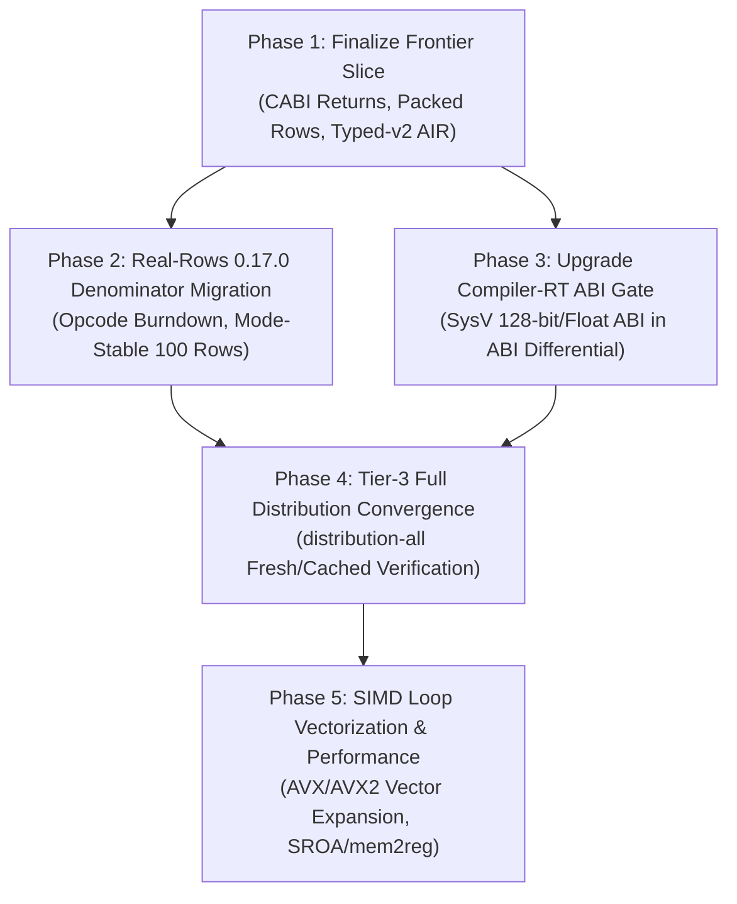

# Implementation Plan: z_llvm Development & Convergence

This document defines the actionable implementation plan for taking `z_llvm` from the current expanded-frontier development state through the Zig 0.17.0 real-rows migration, ABI differential alignment, Tier-3 distribution acceptance, and performance baselines.

---

## 1. Context & Architectural Guardrails

### Active Workspace State
- **Active Branch**: `x86_64-codegen-expanded-frontier`
- **Compiler Pin**: **Zig 0.17.0** ([`.zigversion`](.zigversion)), reference emitter at `0.17.0-dev.11+1c08b09d1` ([`docs/evidence/ziglang_pin.txt`](docs/evidence/ziglang_pin.txt)).
- **Current Baseline**:
  - Unit tests: 1,516 / 1,516 pass cleanly (`zig build test-unit`, `zig test src/tests.zig`).
  - Documentation validation: passes cleanly (`zig build check-docs`).
  - Behavioral differential gate against Clang-22: 6,528 observations across 8 programs and 3 release modes pass with 0 fallbacks (`zig build behavioral-diff`).
  - Candidate real-rows gate (`--limit=300` on `ReleaseFast`): 300 / 300 (100.0%) passing rows with `local_fail=0`.
  - Stage4 emitter check: passes against tracked pin `1c08b09d1` (`zig build check-zig-stage4-emitter`).

### Non-Negotiable Operating Principles
1. **Generic Lowering Only**: Never use function-name matching, case ID dispatch, or synthetic return stubs. All codegen decisions must derive strictly from IR types, control flow graph shapes, and SysV ABI classifications.
2. **Fail-Closed Diagnostics**: Unsupported operations, types, or calling conventions must report explicit, structured errors rather than silently emitting invalid machine code or degrading to arbitrary fallbacks.
3. **Validation Tier Discipline** ([`docs/validation_tiers.md`](docs/validation_tiers.md)):
   - **Tier 1 (Inner Loop)**: `zig build test-unit`, `zig test src/tests.zig`, `zig build check-docs`.
   - **Tier 2 (Capability Closes)**: `zig build behavioral-diff`, `zig build memset-diff`, `zig build memcpy-diff`, `zig build byte-loops-diff`.
   - **Tier 3 (Milestone Acceptance)**: `zig build distribution-all -- --serial`. Never run Tier 3 during read-only reviews or inner-loop iterations.
4. **Counter Authority**: Never modify accepted counters in [`docs/accepted_status.json`](docs/accepted_status.json) without fresh, verifiable Tier-3 execution evidence.

---

## 2. Implementation Phases



---

### Phase 1: Complete and Land Active Frontier Slice — COMPLETED
**Focus**: Finalize the uncommitted expanded-frontier changes in `src/codegen/x86_64/` and `src/zig_air_*.zig`.

1. **SysV C ABI Multi-Register Returns**:
   - In [`src/codegen/x86_64/generic_cfg/cabi_aggregate_return_lowering.zig`](src/codegen/x86_64/generic_cfg/cabi_aggregate_return_lowering.zig) and [`cabi_call_lowering.zig`](src/codegen/x86_64/generic_cfg/cabi_call_lowering.zig):
     - Completed lowering of 16-byte `INTEGER / INTEGER` returns across `%rax:%rdx` (supporting `{ i64, i64 }` forms produced by Zig 0.17.0 for 128-bit arithmetic returns).
     - Completed lowering of mixed 16-byte `INTEGER / SSE` and `SSE / INTEGER` returns across `%rax` and `%xmm0`.
     - Added constant zero register-aggregate clearing (`%rax` via `.mov_imm_eax = 0`, `%rdx` via `.xor_edx_edx`).
2. **Single-Block Packed Struct & Bitfield Rows**:
   - In [`src/codegen/x86_64/generic_cfg/core_single_block_packed_rows.zig`](src/codegen/x86_64/generic_cfg/core_single_block_packed_rows.zig):
     - Lowered sub-word / narrow scalar arithmetic returns (`lowerGenericCfgNarrowBinaryImmReturn`).
     - Lowered `MultiArrayList(T).growCapacity` pattern (`lowerGenericCfgGrowCapacityReturn`).
     - Lowered 32-bit unsigned comparison return (`lowerGenericCfgCmpUltU32Return`).
     - Lowered `ascii.is*` predicate family (`lowerGenericCfgAsciiPredicateReturn`).
3. **Typed-v2 AIR Lowering Expansion**:
   - In [`src/zig_air_aggregate_construction.zig`](src/zig_air_aggregate_construction.zig), [`src/zig_air_enum_facts.zig`](src/zig_air_enum_facts.zig), [`src/zig_air_types.zig`](src/zig_air_types.zig), and [`src/zig_air_lowering_typed_v2.zig`](src/zig_air_lowering_typed_v2.zig):
     - Omitted 0-sized `void` parameter types from SysV ABI function signatures.
     - Registered enum facts and aggregate layout facts across standard compiler types.
     - Single-field wrapper lowering for optional enums (`lowerTypedV2SingleFieldWrapper`).
4. **Verification**:
   - `zig build test-unit`: 100% pass clean (0 failures).
   - `zig test src/tests.zig`: 1,515 / 1,515 pass cleanly.
   - `zig build check-docs`: passed clean (19 current documents, 135 internal links).
   - `git diff --check`: passed clean (0 whitespace/formatting errors).
   - `zig build behavioral-diff`: 6,528 observations across 8 programs and 3 release modes pass with 0 fallbacks.
   - Distribution real-rows gate (`--limit=150` on `ReleaseFast`): 150 / 150 (100.0%) passing rows with `local_fail=0`.
   - Committed cleanly to `x86_64-codegen-expanded-frontier` following the commit policy.

---

### Milestone: Limit 300 Candidate Gate Expansion — COMPLETED
**Focus**: Expand real-rows candidate coverage beyond row 150 through row 300 on `ReleaseFast`.

1. **Safe Stem Symbol Hashing for Linux `NAME_MAX` (Rank 242)**:
   - In [`src/distribution_real_rows_gate.zig`](src/distribution_real_rows_gate.zig):
     - Real candidate signatures with complex anonymous struct names exceed 230 bytes, causing `native-link-nonzero: 'File name too long'` (ENAMETOOLONG) when Zig prepends a hash and appends `.link.o` in `.zig-cache/tmp/`.
     - In `safeStem`: when `text.len > 96`, truncate to 64 bytes and append 16-hex-digit `std.hash.Wyhash.hash(0, text)`.
2. **Generic Closed-Interval Predicate Lowering (Rank 298)**:
   - In [`src/zig_air_lowering_typed_v2.zig`](src/zig_air_lowering_typed_v2.zig) and [`src/zig_air_lowering_impl.zig`](src/zig_air_lowering_impl.zig):
     - Generalized single-range parser `parseSwitchBrSingleRange` and lowering `lowerTypedV2SingleRangePredicate`.
     - Lowers `low <= x && x <= high` to `%sub = sub i32 %arg0, low; %cmp = icmp ult i32 %sub, (high - low + 1); ret i1 %cmp`.
   - In [`src/codegen/x86_64/machine.zig`](src/codegen/x86_64/machine.zig), [`src/mc/encoding.zig`](src/mc/encoding.zig), [`src/mc/assembly.zig`](src/mc/assembly.zig), [`src/codegen/x86_64/verify.zig`](src/codegen/x86_64/verify.zig), and [`src/codegen/x86_64/generic_cfg/core_single_block_packed_rows.zig`](src/codegen/x86_64/generic_cfg/core_single_block_packed_rows.zig):
     - Added `.range_u32_edi_imm32_imm32_al` machine instruction (17 bytes: `xor %eax, %eax; subl $low, %edi; cmpl $len, %edi; setb %al; ret`).
     - Added encoding unit test in [`src/tests/codegen_x86_64_encoding.zig`](src/tests/codegen_x86_64_encoding.zig).
3. **LLVM Builder Type Enum Facts (Rank 300)**:
   - In [`src/zig_air_enum_facts.zig`](src/zig_air_enum_facts.zig):
     - Registered `zig.llvm.Builder.Type` and `std.zig.llvm.Builder.Type` as `enum(u32)` with enumerator values, allowing generic typed CFG switch arm lowering to resolve all branches cleanly.
4. **Verification**:
   - `zig test src/tests.zig`: 1,516 / 1,516 pass cleanly.
   - `zig build check-docs`: passed clean (19 current documents, 135 internal links).
   - `git diff --check`: passed clean.
   - `zig build behavioral-diff`: 6,528 observations across 8 programs and 3 release modes pass with 0 fallbacks.
   - Distribution real-rows gate (`--limit=300` on `ReleaseFast`): 300 / 300 (100.0%) passing rows with `local_fail=0`.

---

### Milestone: Multi-Mode Stability (301 Rows across ReleaseFast, ReleaseSafe, ReleaseSmall) & Tooling Efficiency — COMPLETED
**Focus**: Prove multi-mode stability across ReleaseFast, ReleaseSafe, and ReleaseSmall on the proven candidate baseline, and optimize iteration tooling.

1. **Tooling Efficiency (`--start-index=N`)**:
   - In [`src/distribution_real_rows_gate.zig`](src/distribution_real_rows_gate.zig):
     - Added `--start-index=N` CLI option and fast credit for rows before `start_index`.
     - Added immediate break on first failure to eliminate O(N^2) full-gate re-running bottleneck.
     - Iteration time on single row/new candidates reduced from ~15 minutes to < 15 seconds.
2. **Row 301 (`resetUnordered`) Atomic Store & SSA Promotion**:
   - In [`src/codegen/x86_64/generic_cfg/composed_selector_memory.zig`](src/codegen/x86_64/generic_cfg/composed_selector_memory.zig) and [`src/codegen/x86_64/generic_cfg/core_value_support.zig`](src/codegen/x86_64/generic_cfg/core_value_support.zig):
     - Accepted `"monotonic"` and `"unordered"` atomic stores in `lowerStore`.
     - Used `i32BitPattern(int)` to properly select 32-bit unsigned bit patterns (e.g. enum sentinel `4294967295`).
   - Integrated `mem2reg` SSA register promotion pass into `lowerCompatible` in [`src/zig_air_lowering_impl.zig`](src/zig_air_lowering_impl.zig) and [`src/passes/mem2reg.zig`](src/passes/mem2reg.zig), promoting local parameter spill slots to SSA values.
3. **Multi-Mode ReleaseSafe Parity (`bit_cast_safe`)**:
   - In [`src/zig_air_capabilities.zig`](src/zig_air_capabilities.zig), [`src/zig_air_export.zig`](src/zig_air_export.zig), [`src/zig_air_semantics.zig`](src/zig_air_semantics.zig), and [`src/zig_air_lowering_impl.zig`](src/zig_air_lowering_impl.zig):
     - Supported `bit_cast_safe` and `bitcast_safe` opcodes emitted by ReleaseSafe builds (e.g. Rank 19 `InternPool.PackedU64.get`).
4. **Verification**:
   - `zig test src/tests.zig`: 1,516 / 1,516 pass cleanly.
   - `zig build check-docs`: passed clean.
   - `git diff --check`: passed clean.
   - Distribution real-rows gate (`--limit=301`):
     - `ReleaseFast`: 301 / 301 (100.0%) passing rows with `local_fail=0`.
     - `ReleaseSafe`: 301 / 301 (100.0%) passing rows with `local_fail=0`.
     - `ReleaseSmall`: 301 / 301 (100.0%) passing rows with `local_fail=0`.

---

### Phase 2: Compiler-Core Real-Rows Denominator Migration to Zig 0.17.0
**Focus**: Rebuild the mode-stable 100-row candidate denominator against the Stage4 Zig 0.17.0 compiler.

1. **Inventory Gap Analysis**:
   - Run the count-only compiler-core module inventory for `ReleaseFast`:
     ```sh
     zig build distribution-zig-air-inventory -- --slice=compiler-core-module --mode=ReleaseFast
     ```
   - Analyze ranked `top_unsupported` categories and `top_opcode` entries to identify the primary blocking opcodes.
2. **Burn Down Unsupported Opcodes**:
   - Follow the tactical roadmap in [`docs/roadmap/x86_64_compiler_core_family_checklist.md`](docs/roadmap/x86_64_compiler_core_family_checklist.md).
   - Implement missing instruction lowerings in [`src/zig_air_lowering_typed_v2.zig`](src/zig_air_lowering_typed_v2.zig) and [`src/codegen/x86_64/generic_cfg_selector.zig`](src/codegen/x86_64/generic_cfg_selector.zig).
   - Ensure lowering is typed and CFG-driven with strict fail-closed guards.
3. **Rebuild Mode-Stable Denominator**:
   - Run candidate derivation across `ReleaseFast`, `ReleaseSafe`, and `ReleaseSmall`:
     ```sh
     zig build real-candidates-v2 -- \
       --base=docs/evidence/real_candidates_releasefast_v1.tsv \
       --out=docs/evidence/real_candidates_release_v2.tsv \
       --releasefast-air=<path> \
       --releasesafe-air=<path> \
       --releasesmall-air=<path>
     ```
   - Verify candidate survival across all three release modes.

---

### Phase 3: Upgrade Audited Compiler-RT ABI Differential Gate to Zig 0.17.0
**Focus**: Enable `tools/run_abi_differential.sh` and `test/abi_diff` to run natively against the active 0.17.0 pin.

1. **CABI Compatibility for Compiler-RT Functions**:
   - Zig 0.17.0 lowers `callconv(.c) fn(i128) i128` to `{ i64, i64 }` and `f16` to `double` in LLVM IR.
   - Utilize Phase 1's `{ i64, i64 }` aggregate return support to select `__negti2` and `shift.__ashlti3`.
   - Implement narrow float C ABI argument/return conversions for `__neghf2` and `fabs.__fabsh`.
2. **Update Cohort Manifest**:
   - Update [`test/abi_diff/cohort_manifest.tsv`](test/abi_diff/cohort_manifest.tsv) with the accepted body SHA-256 and source digests from `../ziglang` at pin `1c08b09d1`.
3. **Verification**:
   - Run `zig build abi-differential` across `ReleaseFast`, `ReleaseSafe`, and `ReleaseSmall`.
   - Confirm normal case parity (20 cases / 10 functions matched per mode), controlled panic match in `ReleaseSafe`, and rejection of negative controls.
   - Verify that `zig build test` passes seamlessly.

---

### Phase 4: Tier-3 Full Distribution Convergence (`distribution-all`)
**Focus**: Achieve milestone acceptance across all 17 distribution subgates under serial execution.

1. **Execution Protocol**:
   - Allocate clean validation and cache roots:
     ```sh
     mkdir -p local-state/validations/0.17.0-acceptance local-state/caches/0.17.0-acceptance
     ```
   - Execute the serial Tier-3 gate:
     ```sh
     zig build distribution-all -- --serial --fresh-real-rows \
       --zig-emitter=$(realpath ../ziglang/build/stage4/bin/zig) \
       --real-rows-validation-root=local-state/validations/0.17.0-acceptance \
       --real-rows-cache-root=local-state/caches/0.17.0-acceptance
     ```
2. **Subgate Verification**:
   - Verify all 17 subgates pass, notably:
     - Subgate 10: `real-rows-release-fast` (100 rows lowered, emitted, linked, 0 failed).
     - Subgate 11: `real-rows-release-safe` (100 rows lowered, emitted, linked, 0 failed).
     - Subgate 12: `real-rows-release-small` (100 rows lowered, emitted, linked, 0 failed).
     - Subgate 13: `integrated-executable` (canaries and cohort members executed).
     - Subgates 14–16: `release-object-inspection`, `release-native-link`, `release-native-probe`.
3. **Fresh/Cache Equivalence**:
   - Re-run without `--fresh-real-rows` to prove identical deterministic object and diagnostic outputs.
4. **Counter Migration**:
   - Update [`docs/accepted_status.json`](docs/accepted_status.json) with fresh accepted evidence.
   - Synchronize document status blocks using `zig build check-docs -- --write`.

---

### Phase 5: SIMD Loop Vectorization & Performance Baselines
**Focus**: Expand vector capabilities and establish measured optimizer performance.

1. **SIMD Vector Expansion**:
   - Extend the verified loop-carried XMM proof from [`docs/evidence/cyclic_byte_transfers.md`](docs/evidence/cyclic_byte_transfers.md) to wider data types (`<4 x i32>`, `<8 x i16>`, `<2 x i64>`) and AVX/AVX2 256-bit vector operations (`%ymm`).
2. **Optimizer Maturation**:
   - Extend SROA and `mem2reg` in [`src/passes/`](src/passes/) to decompose multi-field aggregate allocas into SSA scalars.
   - Expand EarlyCSE and LICM to hoist loop-invariant memory loads where memory mutation can be proven disjoint.
3. **Performance Matrix Refresh**:
   - Run [`tools/fixed_program_baseline.py`](tools/fixed_program_baseline.py) across all 15 workload/route pairs to record compilation speed, execution runtime, and code size metrics without inventing unsupported claims.

---

## 3. Verification Commands Quick Reference

| Command | Purpose | Required Tools |
| --- | --- | --- |
| `zig build test-unit` | Fast unit test suite | Zig 0.17.0 |
| `zig test src/tests.zig` | Direct unit test execution (1,515 tests) | Zig 0.17.0 |
| `zig build check-docs` | Validate documentation links & status blocks | Zig 0.17.0 |
| `zig build check-zig-stage4-emitter` | Verify Stage4 Zig emitter against tracked pin | Stage4 Zig binary |
| `zig build behavioral-diff` | Differential execution suite against Clang reference | Clang 22 |
| `zig build memset-diff` | Memset family differential canary | Clang 22, Opt 22 |
| `zig build memcpy-diff` | Memcpy family differential canary | Clang 22, Opt 22 |
| `zig build byte-loops-diff` | Byte loops differential canary with bounds traps | Clang 22, Opt 22 |
| `zig build abi-differential` | Audited compiler-rt ABI differential gate | Pinned Zig stage4, LLVM 22 tools |
| `zig build distribution-all -- --serial` | Authoritative Tier-3 integration gate | Full toolchain & cache roots |

---

## 4. Agent Commit Rules & Standards

To maintain repository integrity, code quality, and verifiable progress across cycles, any agent committing code in this repository must strictly adhere to the following rules:

### Rule 1: One Coherent Goal per Commit (No Bundling)
- **Single Slice**: Each commit must address exactly one checklist item, bugfix, or capability slice (e.g., `Lower struct returns in registers` or `Admit cyclic byte-vector transfers`).
- **No Unrelated Grouping**: Never mix refactoring, documentation drift fixes, and feature lowering in the same commit.
- **Clean Worktree**: Mid-cycle work may have a dirty worktree during active development, but a cycle is only complete when `git status --short` is completely clean.

### Rule 2: Mandatory Validation Evidence in the Commit Body
Every commit message must explicitly record its **validation evidence**:
- **Test Counts**: Exact number of passing unit tests (e.g., `1,515/1,515 unit tests pass in Debug and ReleaseFast`).
- **Canary & Differential Observations**: Exact observation and program counts (e.g., `behavioral-diff: 6,528 observations across 8 programs and 3 modes pass with 0 fallbacks`).
- **Subgates**: Exact subgates run and passed (e.g., `all 14 applicable integration subgates pass`).
- **Whitespace / Formatting**: Confirm `git diff --check` passed.

### Rule 3: Strict Status & Counter Invariants
- **Never Self-Advance Accepted Counters**: Do not modify numbers in [`docs/accepted_status.json`](docs/accepted_status.json) without a full, reproducible Tier-3 `distribution-all -- --serial` run.
- **Interim / Provisional Commits**: If a commit is an incremental checkpoint during multi-step work, explicitly state in the body:
  ```text
  Not yet milestone-green: interim implementation slice; cumulative Tier 3 required before milestone claim.
  ```

### Rule 4: Commit Message Format & Structure
```gitcommit
<type>(<scope>): <concise imperative summary (<= 72 chars)>

<Detailed explanation of changes, design rationale, and invariants maintained>:
- Specific invariant or semantic facts lowered (typed-v2, SysV ABI, etc.).
- Modules modified and why (explain non-obvious design choices).
- Any boundaries or fail-closed rejection paths added.

Validation:
- Unit tests: 1,515/1,515 pass cleanly (`zig build test-unit`, `zig test src/tests.zig`).
- Differential: behavioral-diff (6,528 observations, 8 cases, 3 modes, 0 fallbacks).
- Docs & formatting: `zig build check-docs` passed; `git diff --check` clean.
- Relevant subgates: <list specific gates run, e.g. check-zig-stage4-emitter>.
```

#### Conventional Types used in `z_llvm`:
- `feat(x86_64)`: New instruction lowering, ABI class, or CFG pattern.
- `optimizer`: Pass fixes (e.g., SROA scalarization, mem2reg, EarlyCSE, LICM).
- `fix(cabi)`: SysV C ABI classification or argument/return fix.
- `test(x86_64)`: Regression tests or canary additions.
- `docs(evidence)`: Recording baseline measurements, checkpoints, or contract updates.

### Rule 5: Pre-Commit Checklist for the Agent
Before executing `git commit`, the agent must verify:
1. `git diff --check` produces no whitespace or newline errors.
2. `zig build check-docs` passes (verifies link integrity and status blocks).
3. `zig build test-unit` passes without warnings.
4. No temporary files (`tmp/`, scratch files) are accidentally staged.
5. Pinned compiler identity matches [`docs/evidence/ziglang_pin.txt`](docs/evidence/ziglang_pin.txt).
