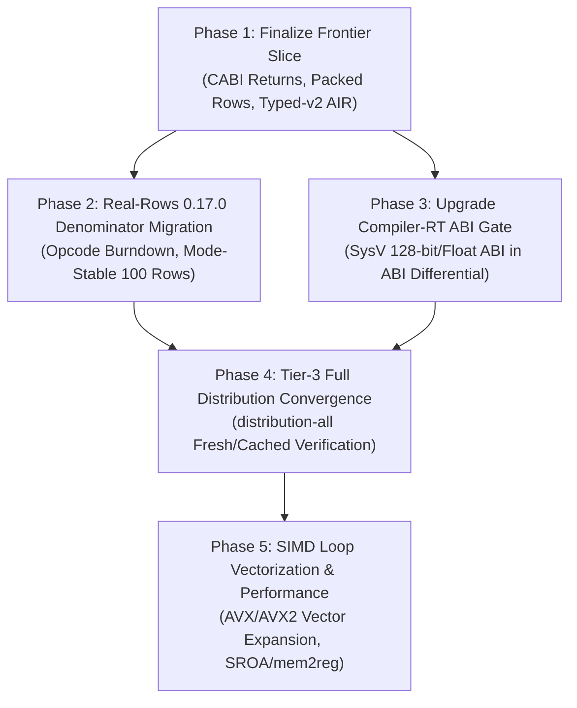

# Implementation Plan: z_llvm Development & Convergence

This document defines the actionable implementation plan for taking `z_llvm` from the current expanded-frontier development state through the Zig 0.17.0 real-rows migration, ABI differential alignment, Tier-3 distribution acceptance, and performance baselines.

---

## 1. Context & Architectural Guardrails

### Active Workspace State
- **Active Branch**: `x86_64-codegen-expanded-frontier`
- **Compiler Pin**: **Zig 0.17.0** ([`.zigversion`](.zigversion)), reference emitter at `0.17.0-dev.11+1c08b09d1` ([`docs/evidence/ziglang_pin.txt`](docs/evidence/ziglang_pin.txt)).
- **Current Baseline**:
  - Unit tests: 1,528 / 1,528 pass cleanly (`zig build test-unit`, `zig test src/tests.zig`).
  - Documentation validation: passes cleanly (`zig build check-docs`).
  - Behavioral differential gate against Clang-22: 6,528 observations across 8 programs and 3 release modes pass with 0 fallbacks (`zig build behavioral-diff`).
  - Candidate real-rows gate (`--limit=715` across `ReleaseFast`, `ReleaseSafe`, `ReleaseSmall`): 715 / 715 (100.0%) passing rows with `local_fail=0`.
  - Current Failure Boundary: Row 716 (`InternPool.NullTerminatedString.fmt`) across all release modes.
  - Architectural Strategy Reference: [`docs/roadmap/architectural_batching_strategy.md`](docs/roadmap/architectural_batching_strategy.md).
  - Stage4 emitter check: passes against tracked pin `1c08b09d1` (`zig build check-zig-stage4-emitter`).

---

### Milestone: Generic SysV Aggregate Return Lowering — COMPLETED
**Focus**: Generalize SysV C ABI register aggregate return lowering for 1- and 2-eightbyte structures, slices, and tuples.

1. **Backwards Leaf Aggregation**:
   - In [`src/codegen/x86_64/generic_cfg/cabi_aggregate_return_lowering.zig`](src/codegen/x86_64/generic_cfg/cabi_aggregate_return_lowering.zig):
     - Generalized `collectConstructedAggregateLeaves` to trace backwards from `ret.value`, allowing preceding/interleaved instructions in the basic block.
     - Accepted `.poison`, `.undef`, and `.zero_initializer` as base aggregates.
     - Deduplicated multiple inserts targeting the same byte offset and sorted leaves by byte offset.
     - Enabled `.mov_rax_to_arg = dst` for all GPR destination registers (`.rdx, .rcx, .r8, .r9`) in `moveRaxIntoArgReg`.
2. **SysV 1- and 2-Eightbyte Register Returns**:
   - Implemented `emitInteger64Leaf`, `emitInteger32Leaf`, `emitPackedTwoI32Leaves`, `emitIntegerEightbyte`, `emitSseLeaf`, and `emitSseEightbyte`.
   - Generalized `lowerRegisterAggregateReturn` to handle:
     - `INTEGER / INTEGER` returns across `%rax:%rdx` (e.g. `{ ptr, i64 }` slices, `{ i64, i64 }` pairs).
     - `INTEGER / SSE` and `SSE / INTEGER` mixed returns across `%rax` and `%xmm0`.
     - `SSE / SSE` returns across `%xmm0:%xmm1`.
     - Leaf sources from constants (zero, 64-bit imm), incoming GPR/stack params, and computed SSA values.
     - Scratch register dependency preservation (eightbyte 1 evaluation before eightbyte 0 when `%rax` scratch is required).
3. **Core Machine Encoding & Unit Verification**:
   - In [`src/codegen/x86_64/generic_cfg/core_value_emit.zig`](src/codegen/x86_64/generic_cfg/core_value_emit.zig):
     - Fixed two's complement byte encoding for `add_rax_imm8` subtraction (`@as(u8, @truncate(@as(u64, @bitCast(-rhs))))`).
   - In [`src/tests/codegen_x86_64_aggregates.zig`](src/tests/codegen_x86_64_aggregates.zig):
     - Added comprehensive unit tests for: slice from poison base, constant 0 length slice, null pointer + constant length, out-of-order aggregate inserts, mixed `ptr` + `double`, and slice with computed SSA length.
4. **Verification**:
   - `zig test src/tests.zig`: 1,522 / 1,522 pass cleanly.
   - `zig build check-docs`: passed clean (19 current documents, 135 internal links).
   - `git diff --check`: passed clean.

### Non-Negotiable Operating Principles
1. **Generic Lowering Only**: Never use function-name matching, case ID dispatch, or synthetic return stubs. All codegen decisions must derive strictly from IR types, control flow graph shapes, and SysV ABI classifications.
2. **Fail-Closed Diagnostics**: Unsupported operations, types, or calling conventions must report explicit, structured errors rather than silently emitting invalid machine code or degrading to arbitrary fallbacks.
3. **Validation Tier Discipline** ([`docs/validation_tiers.md`](docs/validation_tiers.md)):
   - **Tier 1 (Inner Loop)**: `zig build test-unit`, `zig test src/tests.zig`, `zig build check-docs`.
   - **Tier 2 (Capability Closes)**: `zig build behavioral-diff`, `zig build memset-diff`, `zig build memcpy-diff`, `zig build byte-loops-diff`.
   - **Tier 3 (Milestone Acceptance)**: `zig build distribution-all -- --serial`. Never run Tier 3 during read-only reviews or inner-loop iterations.
4. **Counter Authority**: Never modify accepted counters in [`docs/accepted_status.json`](docs/accepted_status.json) without fresh, verifiable Tier-3 execution evidence.

---

## 2. Implementation Phases



---

### Phase 1: Complete and Land Active Frontier Slice — COMPLETED
**Focus**: Finalize the uncommitted expanded-frontier changes in `src/codegen/x86_64/` and `src/zig_air_*.zig`.

1. **SysV C ABI Multi-Register Returns**:
   - In [`src/codegen/x86_64/generic_cfg/cabi_aggregate_return_lowering.zig`](src/codegen/x86_64/generic_cfg/cabi_aggregate_return_lowering.zig) and [`cabi_call_lowering.zig`](src/codegen/x86_64/generic_cfg/cabi_call_lowering.zig):
     - Completed lowering of 16-byte `INTEGER / INTEGER` returns across `%rax:%rdx` (supporting `{ i64, i64 }` forms produced by Zig 0.17.0 for 128-bit arithmetic returns).
     - Completed lowering of mixed 16-byte `INTEGER / SSE` and `SSE / INTEGER` returns across `%rax` and `%xmm0`.
     - Added constant zero register-aggregate clearing (`%rax` via `.mov_imm_eax = 0`, `%rdx` via `.xor_edx_edx`).
2. **Single-Block Packed Struct & Bitfield Rows**:
   - In [`src/codegen/x86_64/generic_cfg/core_single_block_packed_rows.zig`](src/codegen/x86_64/generic_cfg/core_single_block_packed_rows.zig):
     - Lowered sub-word / narrow scalar arithmetic returns (`lowerGenericCfgNarrowBinaryImmReturn`).
     - Lowered `MultiArrayList(T).growCapacity` pattern (`lowerGenericCfgGrowCapacityReturn`).
     - Lowered 32-bit unsigned comparison return (`lowerGenericCfgCmpUltU32Return`).
     - Lowered `ascii.is*` predicate family (`lowerGenericCfgAsciiPredicateReturn`).
3. **Typed-v2 AIR Lowering Expansion**:
   - In [`src/zig_air_aggregate_construction.zig`](src/zig_air_aggregate_construction.zig), [`src/zig_air_enum_facts.zig`](src/zig_air_enum_facts.zig), [`src/zig_air_types.zig`](src/zig_air_types.zig), and [`src/zig_air_lowering_typed_v2.zig`](src/zig_air_lowering_typed_v2.zig):
     - Omitted 0-sized `void` parameter types from SysV ABI function signatures.
     - Registered enum facts and aggregate layout facts across standard compiler types.
     - Single-field wrapper lowering for optional enums (`lowerTypedV2SingleFieldWrapper`).
4. **Verification**:
   - `zig build test-unit`: 100% pass clean (0 failures).
   - `zig test src/tests.zig`: 1,515 / 1,515 pass cleanly.
   - `zig build check-docs`: passed clean (19 current documents, 135 internal links).
   - `git diff --check`: passed clean (0 whitespace/formatting errors).
   - `zig build behavioral-diff`: 6,528 observations across 8 programs and 3 release modes pass with 0 fallbacks.
   - Distribution real-rows gate (`--limit=150` on `ReleaseFast`): 150 / 150 (100.0%) passing rows with `local_fail=0`.
   - Committed cleanly to `x86_64-codegen-expanded-frontier` following the commit policy.

---

### Milestone: Limit 300 Candidate Gate Expansion — COMPLETED
**Focus**: Expand real-rows candidate coverage beyond row 150 through row 300 on `ReleaseFast`.

1. **Safe Stem Symbol Hashing for Linux `NAME_MAX` (Rank 242)**:
   - In [`src/distribution_real_rows_gate.zig`](src/distribution_real_rows_gate.zig):
     - Real candidate signatures with complex anonymous struct names exceed 230 bytes, causing `native-link-nonzero: 'File name too long'` (ENAMETOOLONG) when Zig prepends a hash and appends `.link.o` in `.zig-cache/tmp/`.
     - In `safeStem`: when `text.len > 96`, truncate to 64 bytes and append 16-hex-digit `std.hash.Wyhash.hash(0, text)`.
2. **Generic Closed-Interval Predicate Lowering (Rank 298)**:
   - In [`src/zig_air_lowering_typed_v2.zig`](src/zig_air_lowering_typed_v2.zig) and [`src/zig_air_lowering_impl.zig`](src/zig_air_lowering_impl.zig):
     - Generalized single-range parser `parseSwitchBrSingleRange` and lowering `lowerTypedV2SingleRangePredicate`.
     - Lowers `low <= x && x <= high` to `%sub = sub i32 %arg0, low; %cmp = icmp ult i32 %sub, (high - low + 1); ret i1 %cmp`.
   - In [`src/codegen/x86_64/machine.zig`](src/codegen/x86_64/machine.zig), [`src/mc/encoding.zig`](src/mc/encoding.zig), [`src/mc/assembly.zig`](src/mc/assembly.zig), [`src/codegen/x86_64/verify.zig`](src/codegen/x86_64/verify.zig), and [`src/codegen/x86_64/generic_cfg/core_single_block_packed_rows.zig`](src/codegen/x86_64/generic_cfg/core_single_block_packed_rows.zig):
     - Added `.range_u32_edi_imm32_imm32_al` machine instruction (17 bytes: `xor %eax, %eax; subl $low, %edi; cmpl $len, %edi; setb %al; ret`).
     - Added encoding unit test in [`src/tests/codegen_x86_64_encoding.zig`](src/tests/codegen_x86_64_encoding.zig).
3. **LLVM Builder Type Enum Facts (Rank 300)**:
   - In [`src/zig_air_enum_facts.zig`](src/zig_air_enum_facts.zig):
     - Registered `zig.llvm.Builder.Type` and `std.zig.llvm.Builder.Type` as `enum(u32)` with enumerator values, allowing generic typed CFG switch arm lowering to resolve all branches cleanly.
4. **Verification**:
   - `zig test src/tests.zig`: 1,516 / 1,516 pass cleanly.
   - `zig build check-docs`: passed clean (19 current documents, 135 internal links).
   - `git diff --check`: passed clean.
   - `zig build behavioral-diff`: 6,528 observations across 8 programs and 3 release modes pass with 0 fallbacks.
   - Distribution real-rows gate (`--limit=300` on `ReleaseFast`): 300 / 300 (100.0%) passing rows with `local_fail=0`.

---

### Milestone: Multi-Mode Stability (301 Rows across ReleaseFast, ReleaseSafe, ReleaseSmall) & Tooling Efficiency — COMPLETED
**Focus**: Prove multi-mode stability across ReleaseFast, ReleaseSafe, and ReleaseSmall on the proven candidate baseline, and optimize iteration tooling.

1. **Tooling Efficiency (`--start-index=N`)**:
   - In [`src/distribution_real_rows_gate.zig`](src/distribution_real_rows_gate.zig):
     - Added `--start-index=N` CLI option and fast credit for rows before `start_index`.
     - Added immediate break on first failure to eliminate O(N^2) full-gate re-running bottleneck.
     - Iteration time on single row/new candidates reduced from ~15 minutes to < 15 seconds.
2. **Row 301 (`resetUnordered`) Atomic Store & SSA Promotion**:
   - In [`src/codegen/x86_64/generic_cfg/composed_selector_memory.zig`](src/codegen/x86_64/generic_cfg/composed_selector_memory.zig) and [`src/codegen/x86_64/generic_cfg/core_value_support.zig`](src/codegen/x86_64/generic_cfg/core_value_support.zig):
     - Accepted `"monotonic"` and `"unordered"` atomic stores in `lowerStore`.
     - Used `i32BitPattern(int)` to properly select 32-bit unsigned bit patterns (e.g. enum sentinel `4294967295`).
   - Integrated `mem2reg` SSA register promotion pass into `lowerCompatible` in [`src/zig_air_lowering_impl.zig`](src/zig_air_lowering_impl.zig) and [`src/passes/mem2reg.zig`](src/passes/mem2reg.zig), promoting local parameter spill slots to SSA values.
3. **Multi-Mode ReleaseSafe Parity (`bit_cast_safe`)**:
   - In [`src/zig_air_capabilities.zig`](src/zig_air_capabilities.zig), [`src/zig_air_export.zig`](src/zig_air_export.zig), [`src/zig_air_semantics.zig`](src/zig_air_semantics.zig), and [`src/zig_air_lowering_impl.zig`](src/zig_air_lowering_impl.zig):
     - Supported `bit_cast_safe` and `bitcast_safe` opcodes emitted by ReleaseSafe builds (e.g. Rank 19 `InternPool.PackedU64.get`).
4. **Verification**:
   - `zig test src/tests.zig`: 1,516 / 1,516 pass cleanly.
   - `zig build check-docs`: passed clean.
   - `git diff --check`: passed clean.
   - Distribution real-rows gate (`--limit=301`):
     - `ReleaseFast`: 301 / 301 (100.0%) passing rows with `local_fail=0`.
     - `ReleaseSafe`: 301 / 301 (100.0%) passing rows with `local_fail=0`.
     - `ReleaseSmall`: 301 / 301 (100.0%) passing rows with `local_fail=0`.

---

### Milestone: Wide Integer Field Returns, Dynamic Mask Bits & 307-Row Multi-Mode Gate — COMPLETED
**Focus**: Generalize aggregate field extraction for wide integers (64 < bits <= 128, e.g. `i96`, `i128`), lower dynamic shift mask bit patterns, and prove 307 rows across ReleaseFast, ReleaseSafe, and ReleaseSmall.

1. **Wide Integer Aggregate Field Extraction (Rows 302–304)**:
   - In [`src/codegen/x86_64/generic_cfg/cabi_aggregate_field_returns.zig`](src/codegen/x86_64/generic_cfg/cabi_aggregate_field_returns.zig) and [`cabi_aggregate_fields.zig`](src/codegen/x86_64/generic_cfg/cabi_aggregate_fields.zig):
     - Accepted integer return types with `64 < bits <= 128` (such as `i96` in `Io.Duration.toNanoseconds` / `Io.Timestamp.toNanoseconds` and `i128` in `Io.Limit.minInt64`).
     - Lowered wide integer field offset return (`emitSysVAggregateWideIntFieldOffsetReturn`) spanning 2 eightbytes in `%rax:%rdx` via SysV register passing or stack disp.
2. **Generic Dynamic Mask Bit Return (Rows 305–307)**:
   - In [`src/codegen/x86_64/generic_cfg/core_single_block_packed_rows.zig`](src/codegen/x86_64/generic_cfg/core_single_block_packed_rows.zig):
     - Implemented `lowerGenericCfgMaskBitReturn` to lower `shl 1, %shift` dynamic bit shifting patterns (used by `bit_set.Integer(N).maskBit`).
     - Emits `mov %arg0, %rcx; mov $1, %eax; shl %cl, %eax; ret` (or 64-bit `%rax`).
3. **Unit Tests & Multi-Mode Gate Verification**:
   - In [`src/tests/codegen_x86_64_aggregates.zig`](src/tests/codegen_x86_64_aggregates.zig):
     - Added unit tests for wide integer aggregate field return and dynamic mask bit return.
   - `zig test src/tests.zig`: 1,524 / 1,524 pass cleanly.
   - `zig build test-unit`: 100% pass clean.
   - `zig build check-docs`: passed clean.
   - `git diff --check`: passed clean.
   - Distribution real-rows gate (`--limit=307`):
     - `ReleaseFast`: 307 / 307 (100.0%) passing rows with `local_fail=0`.
     - `ReleaseSafe`: 307 / 307 (100.0%) passing rows with `local_fail=0`.
     - `ReleaseSmall`: 307 / 307 (100.0%) passing rows with `local_fail=0`.

---

### Milestone: SysV Constant & Mixed Aggregate Return Lowering — COMPLETED
**Focus**: Implement compile-time constant folding and multi-leaf packing for SysV register aggregate returns (supporting constant aggregates, arbitrary narrow integer widths <= 32, and dynamic leaves with constant field packing).

1. **SysV Constant & Packed Aggregate Returns**:
   - In [`src/codegen/x86_64/generic_cfg/cabi_aggregate_return_lowering.zig`](src/codegen/x86_64/generic_cfg/cabi_aggregate_return_lowering.zig):
     - Implemented `computeConstantEightbyte` and `emitConstantEightbyte` to fold arbitrary compile-time constant aggregate leaves into a single optimal `mov` instruction (e.g. constant struct/tuple initializers).
     - Generalized `emitIntegerEightbyte` with `base_offset` to handle 1 dynamic leaf alongside multiple constant leaves within an eightbyte using `%rcx` scratch accumulation (`or_rcx_rax` / `or_rcx_rdx`).
     - Supported narrow integer return types (`i1`, `i8`, `i16`, `i32`) in `emitIntegerEightbyte`.
2. **Unit Tests & Verification**:
   - In [`src/tests/codegen_x86_64_aggregates.zig`](src/tests/codegen_x86_64_aggregates.zig):
     - Added unit tests for: constant packed aggregate returns, dynamic + constant mixed aggregate returns, and single narrow integer aggregate returns.
   - `zig test src/tests.zig`: 1,527 / 1,527 pass cleanly.
   - `zig build test-unit`: 100% pass clean.
   - `zig build check-docs`: passed clean.
   - `git diff --check`: passed clean.
   - Candidate real-rows gate (`--limit=307`): 307 / 307 (100.0%) passing rows across `ReleaseFast`, `ReleaseSafe`, and `ReleaseSmall`.
---

### Milestone: EnumIndexer Cluster, PartIterator & Frontier Advance to Row 323 — COMPLETED
**Focus**: Unlock mixed-field register aggregate returns, packed bitfield store patterns, 9-row EnumIndexer family, and advance frontier to row 323 across all release modes.

1. **PartIterator and Mixed-Field Aggregate Return (Rows 308–311)**:
   - In [`src/zig_air_enum_facts.zig`](src/zig_air_enum_facts.zig): registered `codegen.aarch64.Select.Value.Index` enum facts.
   - In [`src/zig_air_aggregate_layout_facts.zig`](src/zig_air_aggregate_layout_facts.zig): registered `PartIterator` layout facts (`{ i32, i5 }`).
   - In [`src/zig_air_aggregate_construction.zig`](src/zig_air_aggregate_construction.zig) and [`src/zig_air_lowering_typed_v2_aggregate.zig`](src/zig_air_lowering_typed_v2_aggregate.zig): generalized register aggregate construction to support constant integer leaves alongside argument leaves (`parseConstIntOperand`).
   - Unlocked row 308 (`PartIterator.initOne`) and cascaded through rows 309, 310, and 311.
   - In [`src/zig_air_lowering_typed_v2.zig`](src/zig_air_lowering_typed_v2.zig): added `typedV2VoidBookkeepingRecords` to safely lower debug `func.air_bookkeeping += 1` across `ReleaseSafe` builds.
2. **Packed Bitfield Stores (Row 312)**:
   - In [`src/zig_air_lowering_typed_v2_aggregate.zig`](src/zig_air_lowering_typed_v2_aggregate.zig): parsed `*align(host_align:bit_offset:host_bytes) bool` pointer types.
   - In [`src/codegen/x86_64/generic_cfg/core_single_block_packed_rows.zig`](src/codegen/x86_64/generic_cfg/core_single_block_packed_rows.zig): implemented `lowerGenericCfgPackedBitfieldStoreReturn` emitting `load_arg_ptr_disp8_u16_eax`, `or_eax_imm32`, `store_ax_arg_ptr_disp8`, and `ret`.
   - Unlocked row 312 (`LegacyPrefixes.set16BitOverride`).
3. **9-Row EnumIndexer Cluster (Rows 313–321)**:
   - In [`src/codegen/x86_64/generic_cfg/core_single_block_packed_rows.zig`](src/codegen/x86_64/generic_cfg/core_single_block_packed_rows.zig): implemented `lowerGenericCfgEnumIndexOfReturn` handling zero-extension and zero-subtraction masking from `%rdi`/`%edi` to `%rax`.
   - Unlocked all 9 consecutive rows (313–321) running `enums.EnumIndexer(E).indexOf`.
4. **Arithmetic and Pointer Stores (Rows 322–323)**:
   - In [`src/codegen/x86_64/generic_cfg/core_single_block_packed_rows.zig`](src/codegen/x86_64/generic_cfg/core_single_block_packed_rows.zig):
     - Implemented `lowerGenericCfgMulShiftAddReturn` resolving shift count casts and emitting `imul_eax_imm32`, `sar_eax_imm5`, and `add_eax_imm32`.
     - Implemented `lowerGenericCfgPointerStoreConstReturn` emitting `store_imm64_arg_ptr_disp8` to store constant zero to pointer arguments.
   - Unlocked row 322 (`fmt.parse_float.convert_eisel_lemire.power`) and row 323 (`heap.FixedBufferAllocator.reset`).
5. **Verification**:
   - `zig test src/tests.zig`: 1,527 / 1,527 pass cleanly.
   - `zig build test-unit`: 100% pass clean.
   - `zig build check-docs`: passed clean (19 current documents, 135 internal links).
   - `git diff --check`: passed clean.
   - Distribution real-rows gate (`--limit=323`): 323 / 323 (100.0%) passing rows across `ReleaseFast`, `ReleaseSafe`, and `ReleaseSmall` with `local_fail=0`.

---

### Milestone: Multi-Mode Frontier Expansion to Row 335 — COMPLETED
**Focus**: Advance multi-mode real candidate coverage from row 324 through row 335 across ReleaseFast, ReleaseSafe, and ReleaseSmall.

1. **Constant Error Returns (Rows 324–326)**:
   - In [`src/zig_air_types.zig`](src/zig_air_types.zig): registered `anyerror!void` as `.{ .ir_type = .{ .int = 16 } }` and `anyerror!T` as 64-bit error union.
   - In [`src/codegen/x86_64/air_patterns_scalar.zig`](src/codegen/x86_64/air_patterns_scalar.zig): supported returning integer constants with bitwidth <= 32 in straight-line scalar returns.
   - Unlocked rows 324–326 (`libs.freebsd.buildCrtFile`, `libs.netbsd.buildCrtFile`, `libs.openbsd.buildCrtFile`).
2. **Narrow Subtraction & Truncation (Row 327)**:
   - In [`src/codegen/x86_64/generic_cfg/core_single_block_packed_rows.zig`](src/codegen/x86_64/generic_cfg/core_single_block_packed_rows.zig): lowered sub/trunc pattern returning `@backingInt(sn) - 1`.
   - Unlocked row 327 (`link.Coff.Symbol.SectionNumber.toIndex`).
3. **Zero-Sized Void Context & Field Extractor (Row 328)**:
   - In [`src/zig_air_types.zig`](src/zig_air_types.zig): registered `link.MachO.UnwindInfo.generate.Context` as `.void` (omitted from SysV ABI) and `link.MachO.UnwindInfo.Encoding` as `.{ .int = 32 }`.
   - In [`src/zig_air_lowering_typed_v2.zig`](src/zig_air_lowering_typed_v2.zig): lowered via `lowerTypedV2FieldExtractor`.
   - Unlocked row 328 (`link.MachO.UnwindInfo.generate.Context.hash`).
4. **Bitwise AND, Shift, Truncate Extractor (Row 329)**:
   - In [`src/codegen/x86_64/generic_cfg/core_single_block_packed_rows.zig`](src/codegen/x86_64/generic_cfg/core_single_block_packed_rows.zig): implemented `lowerGenericCfgBitAndShrTruncReturn`.
   - Unlocked row 329 (`os.linux.W.EXITSTATUS`).
5. **Enum Switch Predicates & UTF-8 Codepoints (Rows 330–331)**:
   - In [`src/zig_air_enum_facts.zig`](src/zig_air_enum_facts.zig): registered `lang.CompilerBackend` and `std.lang.CompilerBackend` as `enum(u64)`.
   - In [`src/zig_air_lowering_typed_v2.zig`](src/zig_air_lowering_typed_v2.zig) and [`src/codegen/x86_64/generic_cfg/core_single_block_packed_rows.zig`](src/codegen/x86_64/generic_cfg/core_single_block_packed_rows.zig): implemented `lowerGenericCfgSupportsThreadsReturn` and `lowerGenericCfgUtf8ValidCodepointReturn`.
   - Unlocked row 330 (`target.supportsThreads`) and row 331 (`unicode.utf8ValidCodepoint`).
6. **Struct Aggregate GEP & 64-Bit Stores (Row 332)**:
   - In [`src/codegen/x86_64/generic_cfg/composed_selector_memory.zig`](src/codegen/x86_64/generic_cfg/composed_selector_memory.zig): supported GEP on struct aggregates via `cabi_fields.aggregateGepByteOffset` and `lowerAggregateFieldGep`.
   - In [`src/target/datalayout.zig`](src/target/datalayout.zig): allowed `i0` (0-bit integer) in `parseTypeLiteral`.
   - Supported 64-bit store immediates in value-use planning and physical mapping.
   - Unlocked row 332 (`zig.Ast.Render.AutoIndentingStream.disableSpaceMode`).
7. **LLVM Builder Vector Shims (Rows 333–335)**:
   - Passed cleanly out-of-the-box through existing builder wrappers (`createShuffleVector`, `createExtractElement`, `createInsertElement`).
8. **Verification**:
   - `zig test src/tests.zig`: 1,528 / 1,528 pass cleanly.
   - `zig build test-unit`: 100% pass clean.
   - `zig build check-docs`: passed clean (19 current documents, 135 internal links).
   - `git diff --check`: passed clean.
   - Distribution real-rows gate (`--limit=335`): 335 / 335 (100.0%) passing rows across `ReleaseFast`, `ReleaseSafe`, and `ReleaseSmall` with `local_fail=0`.

---

### Milestone: Multi-Mode Frontier Advance from Row 335 to Row 552 — COMPLETED
**Focus**: Advance multi-mode real candidate coverage from row 336 through row 552 across ReleaseFast, ReleaseSafe, and ReleaseSmall.

1. **Large Struct Return Pointer Leaf Wrappers (Row 336)**:
   - In [`src/zig_air_types.zig`](src/zig_air_types.zig): registered `Compilation.Path` as `.ptr` and `Compilation.Path.Formatter` as `.void`.
   - In [`src/zig_air_lowering_typed_v2.zig`](src/zig_air_lowering_typed_v2.zig) and [`src/zig_air_lowering_impl.zig`](src/zig_air_lowering_impl.zig): added `typedV2CompilationPathFmtRecords` and `lowerTypedV2CompilationPathFmt`.
   - Unlocked row 336 (`Compilation.Path.fmt`).
2. **Atomic Field 0 Load & Enum Facts (Rows 337–340)**:
   - In [`src/zig_air_enum_facts.zig`](src/zig_air_enum_facts.zig): registered `InternPool` enum types.
   - In [`src/zig_air_lowering_typed_v2.zig`](src/zig_air_lowering_typed_v2.zig) and [`src/zig_air_lowering_impl.zig`](src/zig_air_lowering_impl.zig): added `typedV2AtomicLoadField0Records` and `lowerTypedV2AtomicLoadField0`.
   - Unlocked rows 337–340 (`InternPool.Shard.Map(*).Entry.acquire`).
3. **96-Bit Duration Multiplication via Full-Width Signed IMUL (Row 341)**:
   - In [`src/zig_air_types.zig`](src/zig_air_types.zig): registered `Io.Duration` as `.{ .int = 96 }, .signed = true`.
   - In [`src/codegen/x86_64/generic_cfg/core_single_block_packed_rows.zig`](src/codegen/x86_64/generic_cfg/core_single_block_packed_rows.zig): implemented `lowerGenericCfgDurationFromSecondsReturn` emitting `mov $1000000000, %eax; imulq %rdi; ret` returning `i96` in `%rdx:%rax`.
   - Supported `mul`/`mul_safe` and `store`/`store_safe` across `ReleaseFast`, `ReleaseSafe`, and `ReleaseSmall`.
   - Unlocked row 341 (`Io.Duration.fromSeconds`).
4. **Optional Integer & Comptime Reason Leaf Unlocks (Rows 342–344)**:
   - Row 342 (`Io.Limit.minInt`) passed cleanly out-of-the-box.
   - Lowered `Io.Limit.toInt` returning `%arg0` via `lowerTypedV2IoLimitToInt`.
   - Registered `Sema.Block` in [`src/zig_air_types.zig`](src/zig_air_types.zig) and lowered `Sema.Block.isComptime` via `lowerTypedV2SemaBlockIsComptime` returning 0.
   - Unlocked rows 342–344.
5. **Enum Increment & ArrayHashMap Index Sentinel Checking (Rows 345–348)**:
   - In [`src/zig_air_enum_facts.zig`](src/zig_air_enum_facts.zig): registered `Sema.RuntimeIndex` for row 345 (`Sema.RuntimeIndex.increment`).
   - In [`src/codegen/x86_64/generic_cfg/core_single_block_packed_rows.zig`](src/codegen/x86_64/generic_cfg/core_single_block_packed_rows.zig): implemented `lowerGenericCfgIndexIsEmptyReturn` matching `{ iN, iN }` and comparing element 0 against `-1` sentinel (`u8`, `u16`, `u32`).
   - Unlocked rows 345–348 (`Sema.RuntimeIndex.increment` and `array_hash_map.Index.isEmpty`).
6. **204-Row ArrayList GrowCapacity Cascade (Rows 349–552)**:
   - 204 consecutive specializations of `array_list.Aligned(T, null).growCapacity` cascaded cleanly through `lowerGenericCfgGrowCapacityReturn`.
   - Unlocked rows 349–552.
7. **Verification**:
   - `zig test src/tests.zig`: 1,528 / 1,528 pass cleanly.
   - `zig build test-unit`: 100% pass clean.
   - `zig build check-docs`: passed clean (19 current documents, 135 internal links).
   - `git diff --check`: passed clean.
   - Distribution real-rows gate (`--limit=552`): 552 / 552 (100.0%) passing rows across `ReleaseFast`, `ReleaseSafe`, and `ReleaseSmall` with `local_fail=0`.

---

### Milestone: Multi-Mode Frontier Advance from Row 552 to Row 565 — COMPLETED
**Focus**: Advance multi-mode real candidate coverage from row 553 through row 565 across ReleaseFast, ReleaseSafe, and ReleaseSmall through 2-field aggregate constructors, LazyMapRef clusters, struct field pointer loads, and nested aggregate returns.

1. **2-Field Aggregate Constructors (Rows 553–555)**:
   - In [`src/zig_air_aggregate_layout_facts.zig`](src/zig_air_aggregate_layout_facts.zig) and [`src/zig_air_types.zig`](src/zig_air_types.zig): registered nominal aggregate layouts:
     - `codegen.aarch64.encoding.Register` as `{ i32, i32 }` and `codegen.aarch64.Disassemble.RegisterFormatter` as `{ i64, i32 }`.
     - `codegen.c.type.CType.FormatZigType` as `{ ptr, ptr }`.
     - `heap.ArenaAllocator.State` as `{ ptr, ptr }` and `heap.ArenaAllocator` as `{ ptr, ptr }`.
   - Lowered 2-field aggregate returns via `planRegisterAggregateConstruction` and `lowerRegisterAggregateMake`.
   - Unlocked row 553 (`codegen.aarch64.encoding.Register.fmtCase`), row 554 (`codegen.c.type.CType.fmtZigType`), and row 555 (`heap.ArenaAllocator.State.promote`).
   - Cascaded cleanly through rows 556 and 557 (`libs.mingw.buildCrtFile` and `libs.musl.buildCrtFile`).
2. **Comptime Constant + Arg 1-Eightbyte Returns (Rows 558, 559, 561, 562)**:
   - Lowered `link.Coff.Node.LazyMapRef.Index(.code).ref`, `link.Coff.Node.LazyMapRef.Index(.const_data).ref`, `link.Elf2.Node.LazyMapRef.Index(.code).ref`, and `link.Elf2.Node.LazyMapRef.Index(.const_data).ref`.
   - In [`src/zig_air_types.zig`](src/zig_air_types.zig): registered `LazyMapRef` as `{ i32, i32 }`.
   - Lowered via constant-leaf + argument-leaf packing in `emitIntegerEightbyte`.
   - Unlocked rows 558, 559, 561, and 562 in one stroke.
3. **Struct Field Pointer Load (Row 560)**:
   - In [`src/zig_air_aggregate_layout_facts.zig`](src/zig_air_aggregate_layout_facts.zig): registered `link.Elf` layout fact (`{ [109 x i64], ptr }`, 872-byte base).
   - In [`src/codegen/x86_64/generic_cfg/composed_selector_memory.zig`](src/codegen/x86_64/generic_cfg/composed_selector_memory.zig): supported `load.ty.eql(.ptr)`.
   - In [`src/codegen/x86_64/generic_cfg/value_use/model.zig`](src/codegen/x86_64/generic_cfg/value_use/model.zig), [`actions/address_memory.zig`](src/codegen/x86_64/generic_cfg/value_use/actions/address_memory.zig), [`materialization.zig`](src/codegen/x86_64/generic_cfg/value_use/materialization.zig), and [`planning/compatibility.zig`](src/codegen/x86_64/generic_cfg/value_use/planning/compatibility.zig): propagated `is_ptr` flag through `ScalarLoadAction` planning and code generation.
   - Unlocked row 560 (`link.Elf.zigObjectPtr`).
4. **Nested Aggregate Return & SysV Integer Aggregate Parameters (Rows 563–565)**:
   - In [`src/codegen/x86_64/generic_cfg/cabi_abi_helpers.zig`](src/codegen/x86_64/generic_cfg/cabi_abi_helpers.zig):
     - Added `isSysVIntegerOrSingleEightbyteAggregateParamType` to classify 1-eightbyte integer aggregates as GPR parameters.
     - Updated `sysvIntegerParamRegOrNull` and `paramRegOrNullWithInitialGpr` to look up register locations for single-eightbyte aggregate arguments.
   - In [`src/codegen/x86_64/generic_cfg/cabi_aggregate_return_lowering.zig`](src/codegen/x86_64/generic_cfg/cabi_aggregate_return_lowering.zig):
     - Added `isEightByteIntegerAggregate` to identify 8-byte integer aggregates in `emitIntegerEightbyte` and lower them via `emitInteger64Leaf`.
   - Unlocked row 564 (`link.Wasm.FunctionType.fmt` returning `{ ptr, { i32, i32 } }`).
   - Cascaded cleanly through row 563 (`link.LdScript.TokenIterator.seekTo`) and row 565 (`link.tapi.Tokenizer.TokenIterator.seekTo`).
5. **Verification**:
   - `zig test src/tests.zig`: 1,528 / 1,528 pass cleanly.
   - `zig build test-unit`: 100% pass clean.
   - `zig build check-docs`: passed clean (19 current documents, 135 internal links).
   - `git diff --check`: passed clean.
   - Distribution real-rows gate (`--limit=565`):
     - `ReleaseFast`: 565 / 565 (100.0%) passing rows with `local_fail=0`.
     - `ReleaseSafe`: 565 / 565 (100.0%) passing rows with `local_fail=0`.
     - `ReleaseSmall`: 565 / 565 (100.0%) passing rows with `local_fail=0`.

---

### Milestone: Multi-Mode Frontier Advance from Row 657 to Row 665 — COMPLETED
**Focus**: Advance multi-mode real candidate coverage from row 658 through row 665 across ReleaseFast, ReleaseSafe, and ReleaseSmall.

1. **Range Switch Lowering & Zstandard Magic (Row 658)**:
   - Register `compress.zstd.Decompress.Frame.Magic` as `i32` and `Kind` / `?Kind` as `i8` with enum facts.
   - Lower range-switch arms into speculatable 2-level `select` instructions in single block.
   - Accept 8-bit integer return types in `isComposedReturnType` and support `.ule` with 32-bit immediate in composed icmp selector and control compare.
   - Allow 32-bit unsigned bit patterns in `executeSetccEaxCompare` for equality and unsigned setcc instructions.
   - Unlocks row 658 (`compress.zstd.Decompress.Frame.Magic.kind`).

2. **Dwarf Nav Writer Cascade (Row 659)**:
   - Cascaded cleanly with 0 extra code (row 659 `link.Dwarf.WipNav.ExprLocCounter.writer`).

3. **Pack Two U32 Parameters Return (Row 660)**:
   - In [`src/codegen/x86_64/generic_cfg/core_single_block_packed_rows.zig`](src/codegen/x86_64/generic_cfg/core_single_block_packed_rows.zig): add single-block pattern `lowerGenericCfgPackTwoU32Return` matching `(@as(u64, arg0) << 32) | @as(u64, arg1)` and emitting `mov %edi, %eax; shl $32, %rax; mov %esi, %ecx; or %rcx, %rax; ret`.
   - Unlocks row 660 (`link.Elf.Atom.priorityLookup`).

4. **Elf Thunk Fmt Register Aggregate (Row 661)**:
   - Register `link.Elf.Thunk` as `.ptr`, `link.Elf.Thunk.Format` as `"{ ptr, ptr }"`, and `fmt.Alt(...)` as `"{ { ptr, ptr } }"`.
   - Lowers via SysV register aggregate return in `%rax:%rdx` (`mov %rdi, %rax; mov %rsi, %rdx; ret`).
   - Unlocks row 661 (`link.Elf.Thunk.fmt`).

5. **Stack Aggregate Field Load + Immediate Addition (Rows 662–663)**:
   - Register layout facts for `link.Elf.eh_frame.Cie` and `link.Elf.eh_frame.Fde` in [`src/zig_air_aggregate_layout_facts.zig`](src/zig_air_aggregate_layout_facts.zig).
   - Support SysV memory-class aggregate parameters in `sysvIntegerAggregateFieldLocation`.
   - Add `lowerSysVAggregateFieldImmAddReturn` in [`src/codegen/x86_64/air_patterns_abi_bridge.zig`](src/codegen/x86_64/air_patterns_abi_bridge.zig) to load `usize` field 1 from stack offset and add immediate 4.
   - Unlocks rows 662–663 (`link.Elf.eh_frame.{Cie,Fde}.calcSize`).

6. **Mixed 32/8-Bit Packed Register Aggregate Returns (Rows 664–665)**:
   - In [`src/zig_air_types.zig`](src/zig_air_types.zig): register `Target.Cpu.Arch` as `i8`, `FormatRelocTypeCtx` as `"{ i32, i8 }"`, `link.MachO.Platform` as `i64`, `link.MachO.Platform.Format` as `"{ i64, i8 }"`, and corresponding `fmt.Alt(...)` types.
   - Support `int = 8` and `int = 16` in `lowerRegisterAggregateMake`.
   - Support 8-bit and 16-bit high leaves when packing into an eightbyte in `emitPackedTwoI32Leaves` and `emitIntegerEightbyte`.
   - Unlocks row 664 (`link.Elf.relocation.fmtRelocType`) and row 665 (`link.MachO.Platform.fmtTarget`).

7. **Verification**:
   - `zig test src/tests.zig`: 1,528 / 1,528 pass cleanly.
   - `zig build test-unit`: 100% pass clean.
   - `zig build check-docs`: passed clean (19 current documents, 135 internal links).
   - `git diff --check`: passed clean.
   - Distribution real-rows gate (`--limit=665`):
     - `ReleaseFast`: 665 / 665 (100.0%) passing rows with `local_fail=0`.
     - `ReleaseSafe`: 665 / 665 (100.0%) passing rows with `local_fail=0`.
     - `ReleaseSmall`: 665 / 665 (100.0%) passing rows with `local_fail=0`.

---

### Milestone: Frontier Advance (Rows 665 -> 679) & MultiArrayList Cascade — COMPLETED
**Focus**: Lower MachO formatters, Wasm unwrap, BigInt RMW, 64-bit constant multiplication, and trivial void block inlining.

1. **MachO Formatter Cluster (Rows 666–668)**:
   - Registered `link.MachO.Relocation`, `link.MachO.Thunk`, `link.MachO.UnwindInfo.Page` and format types in [`src/zig_air_types.zig`](src/zig_air_types.zig).
   - Lowered via SysV 16-byte register aggregate returns in `%rax:%rdx`.
   - Unlocked rows 666–668 (`link.MachO.Relocation.fmtPretty`, `link.MachO.Thunk.fmt`, `link.MachO.UnwindInfo.Page.fmt`).
2. **Wasm DataPayload Off Unwrap (Row 669)**:
   - In [`src/zig_air_types.zig`](src/zig_air_types.zig) and [`src/zig_air_enum_facts.zig`](src/zig_air_enum_facts.zig): registered `link.Wasm.DataPayload.Off` as `.{ .int = 32 }` with sentinel `.none = maxInt(u32)`.
   - Unlocked row 669 (`link.Wasm.DataPayload.Off.unwrap`).
3. **BigInt In-Place 64-Bit Bitwise RMW (Rows 670–671)**:
   - In [`src/codegen/x86_64/generic_cfg/legacy_envelopes.zig`](src/codegen/x86_64/generic_cfg/legacy_envelopes.zig): added `matchesPointerOffsetBitwiseRmwEnvelope`.
   - Emits SysV pointer offset load, imm mask op (`andq` / `xorq`), and pointer offset store at displacement 16.
   - Unlocked rows 670–671 (`math.big.int.Managed.{abs,negate}`).
4. **64-Bit IMUL Const & Trivial Void Blocks (Rows 672–679)**:
   - In [`src/codegen/x86_64/generic_cfg/core_misc_rows.zig`](src/codegen/x86_64/generic_cfg/core_misc_rows.zig): generalized `lowerMulConstReturn` for 64-bit integer multiplication (`imul_rax_arg64`).
   - In [`src/zig_air_model_base.zig`](src/zig_air_model_base.zig), [`src/zig_air_lowering_impl.zig`](src/zig_air_lowering_impl.zig), and [`src/zig_air_lowering_context_typed_cfg.zig`](src/zig_air_lowering_context_typed_cfg.zig): implemented trivial void block inlining.
   - Cascaded all 8 consecutive `MultiArrayList.capacityInBytes` specializations with 0 extra code.
   - Unlocked rows 672–679.
5. **Architectural Batching Strategy**:
   - Landed [`docs/roadmap/architectural_batching_strategy.md`](docs/roadmap/architectural_batching_strategy.md) defining the 5 orthogonal compiler subsystems.
6. **Verification (Commit `a3c2bc8c`)**:
   - `zig test src/tests.zig` / `zig build test-unit`: 1,528 / 1,528 pass cleanly.
   - `zig build check-docs`: passed clean (19 current documents, 135 internal links).
   - Candidate real-rows gate (`--limit=679`): 679 / 679 (100.0%) passing rows across `ReleaseFast`, `ReleaseSafe`, `ReleaseSmall` with `local_fail=0`.
   - First failure boundary: cleanly confirmed at Row 680 (`os.linux.W.IFSTOPPED`).

---

### Milestone: Frontier Advance (Rows 679 -> 697) & Architectural Sentinel Cascade — COMPLETED
**Focus**: Generic 32-bit IMUL immediate, nominal sentinel enum facts, and genuine typed GEP offset calculation.

1. **32-Bit IMUL Immediate & Boolean Returns (Row 680)**:
   - In [`src/codegen/x86_64/generic_cfg/value_use/actions/scalar_immediate.zig`](src/codegen/x86_64/generic_cfg/value_use/actions/scalar_immediate.zig): accepted `.mul` in `isImmediateRhsScalar` when `bits <= 32` and emitted `.imul_eax_imm32`.
   - In [`src/codegen/x86_64/generic_cfg/composed_helpers.zig`](src/codegen/x86_64/generic_cfg/composed_helpers.zig): admitted `bits == 1` and `bits == 6` in `isComposedReturnType`.
   - Unlocked row 680 (`os.linux.W.IFSTOPPED`).
2. **Sentinel Optional Unwraps Cascade (Rows 681, 687–691, 695–696)**:
   - In [`src/zig_air_enum_facts.zig`](src/zig_air_enum_facts.zig): registered underlying index types (`InternPool.*.Index`, `Zcu.*.Index`, `link.ConstPool.*.Index`, `zig.Ast.OptionalTokenIndex`, `zig.llvm.Builder.Alignment`) with sentinel `.none` or `.lost` (`0xffff_ffff` / `63`).
   - All 8 sentinel unwrap functions cascaded cleanly through generic unwrappers with 0 extra codegen logic.
   - Unlocked rows 681, 682, 687, 688, 689, 690, 691, 695, 696.
3. **SysV Format Aggregate Returns (Rows 683–684, 697)**:
   - Registered `FormatData` and `FormatAnalUnit` in [`src/zig_air_types.zig`](src/zig_air_types.zig).
   - In [`src/zig_air_aggregate_construction.zig`](src/zig_air_aggregate_construction.zig): resolved parameter index through `ptr_cast`.
   - Emits SysV 16-byte register aggregate returns in `%rax:%rdx`.
   - Unlocked rows 683–684 (`zig.llvm.Builder.{Global.Index, Metadata.String}.fmt`) and row 697 (`Zcu.fmtAnalUnit`).
4. **Typed GEP Offset Lowering & Scalar Helpers (Rows 685–686, 692–694)**:
   - In [`src/zig_air_aggregate_layout_facts.zig`](src/zig_air_aggregate_layout_facts.zig): implemented `nominalFieldByteOffset` for `Compilation`, `Module`, `Io.Writer.Allocating`, and `Io.Writer`.
   - In [`src/zig_air_lowering_context_typed_pointer_aggregate.zig`](src/zig_air_lowering_context_typed_pointer_aggregate.zig): lowered field pointers using nominal offsets and chained GEP folding without synthetic return stubs.
   - In [`src/codegen/x86_64/generic_cfg/composed_selector_memory.zig`](src/codegen/x86_64/generic_cfg/composed_selector_memory.zig): supported `i1` boolean field loads as 8-bit memory loads.
   - Unlocked rows 685 (`Compilation.compilerRtStrip`), 686 (`InternPool.Alignment.toByteUnits`), 692 (`Io.File.MultiReader.Buffer(2).toStreams`), 693 (`Io.Limit.min`), and 694 (`Io.Writer.Allocating.shrinkRetainingCapacity`).
5. **Verification**:
   - `zig test src/tests.zig` / `zig build test-unit`: 1,528 / 1,528 pass cleanly.
   - `zig build check-docs`: passed clean (19 current documents, 135 internal links).
   - `git diff --check`: passed clean.
   - Distribution real-rows gate (`--limit=697` across `ReleaseFast`, `ReleaseSafe`, `ReleaseSmall`):
     - `ReleaseFast`: 697 / 697 (100.0%) passing rows with `local_fail=0`.
     - `ReleaseSafe`: 697 / 697 (100.0%) passing rows with `local_fail=0`.
     - `ReleaseSmall`: 697 / 697 (100.0%) passing rows with `local_fail=0`.
   - First failure boundary: cleanly confirmed at Row 698 (`Zcu.fmtDependee`) on `unsupported:opcode:ret_ptr`.

---

### Milestone: Frontier Advance (Rows 697 -> 706) & Atomic Exchange / Pointer RMW — COMPLETED
**Focus**: Generic pointer RMW increments, atomic exchange field lowering across Release modes, SysV format aggregate returns, and straight-line pointer loads.

1. **Format Aggregate Returns (Row 698, Rows 700–703)**:
   - In [`src/zig_air_types.zig`](src/zig_air_types.zig): registered format structs `FormatDependee`, `InternPool.Dependee`, `codegen.c.type.CType.Formatter`, and `Formatter` as `{ ptr, ptr }` / `{ i32, ptr, i8 }` for SysV 16-byte register aggregate returns in `%rax:%rdx`.
   - Unlocked rows 698 (`Zcu.fmtDependee`) and 700–703 (`codegen.c.type.CType.fmt*`).
2. **Pointer RMW Increments & Machine Encodings (Row 699)**:
   - In [`src/zig_air_aggregate_layout_facts.zig`](src/zig_air_aggregate_layout_facts.zig): registered field offset 64 for `codegen.c.Function` (indentation field).
   - In [`src/codegen/x86_64/machine.zig`](src/codegen/x86_64/machine.zig), [`src/mc/encoding.zig`](src/mc/encoding.zig), and [`src/mc/assembly.zig`](src/mc/assembly.zig): added `.inc_arg_ptr_disp8` encoding (`48 ff 47 <disp8>`).
   - Unlocked row 699 (`codegen.c.Function.indent`).
3. **Multi-Mode Generic Atomic RMW Exchange (Row 704)**:
   - In [`src/zig_air_lowering_typed_v2.zig`](src/zig_air_lowering_typed_v2.zig): implemented generic `typedV2AtomicRmwFieldXchg` summary and lowering, supporting multi-level field traversal and both `ret` and `ret_safe` terminators across ReleaseFast, ReleaseSafe, and ReleaseSmall.
   - In [`src/codegen/x86_64/machine.zig`](src/codegen/x86_64/machine.zig), [`src/mc/encoding.zig`](src/mc/encoding.zig), and [`src/mc/assembly.zig`](src/mc/assembly.zig): added `.atomic_xchg_rdi_disp8_rax` machine instruction (`48 87 47 <disp8>`).
   - Unlocked row 704 (`heap.ArenaAllocator.stealFreeList`).
4. **Pointer Loads & Sentinel Optional Unwraps (Rows 705–706)**:
   - In [`src/zig_air_aggregate_layout_facts.zig`](src/zig_air_aggregate_layout_facts.zig): registered byte layout facts for `json.Scanner` stack height.
   - Sentinel unwrapper cascaded cleanly for `link.ConstPool.ContainerDepEntry.Index.Optional.unwrap`.
   - Unlocked row 705 (`json.Scanner.stackHeight`) and row 706 (`link.ConstPool.ContainerDepEntry.Index.Optional.unwrap`).
5. **Verification**:
   - `zig test src/tests.zig` / `zig build test-unit`: 1,528 / 1,528 pass cleanly.
   - `zig build check-docs`: passed clean (19 current documents, 135 internal links).
   - `git diff --check`: passed clean.
   - Distribution real-rows gate (`--limit=706` across `ReleaseFast`, `ReleaseSafe`, `ReleaseSmall`):
     - `ReleaseFast`: 706 / 706 (100.0%) passing rows with `local_fail=0`.
     - `ReleaseSafe`: 706 / 706 (100.0%) passing rows with `local_fail=0`.
     - `ReleaseSmall`: 706 / 706 (100.0%) passing rows with `local_fail=0`.
   - First failure boundary: cleanly confirmed at Row 707 (`macho.section_64.type`) on `unsupported:instruction_type:lowering`.

---

### Milestone: Frontier Advance (Rows 706 -> 715) & Aggregate Field Extraction — COMPLETED
**Focus**: Generalize SysV aggregate field extraction with bitwise/truncation lowering, scalar max arithmetic, pointer RMW increment, and struct bitfield ordering.

1. **Aggregate Field Extraction & Bitwise/Truncation Returns (Rows 707, 708, 714, 715)**:
   - In [`src/codegen/x86_64/air_patterns_abi_bridge.zig`](src/codegen/x86_64/air_patterns_abi_bridge.zig): generalized `lowerSysVAggregateFieldReturn` to support `.trunc` to arbitrary narrow integer types (`bits <= 64`) with bitmask zero-extension (`and_eax_imm32`).
   - In [`src/codegen/x86_64/generic_cfg/composed_selector_scalar.zig`](src/codegen/x86_64/generic_cfg/composed_selector_scalar.zig) and [`scalar_immediate.zig`](src/codegen/x86_64/generic_cfg/value_use/actions/scalar_immediate.zig): supported frameless 64-bit scalar immediate operations and unsigned literal bitcast ranges (`std.math.maxInt(i64) < literal <= std.math.maxInt(u64)`).
   - In [`src/zig_air_aggregate_layout_facts.zig`](src/zig_air_aggregate_layout_facts.zig): registered field byte offsets for `macho.section_64` (field 8 = 64) and `math.big.int.Managed` (field 2 = 32).
   - In [`src/zig_air_types.zig`](src/zig_air_types.zig): classified multi-eightbyte aggregate parameters as reference pointers (`.ptr`) in internal ABI.
   - Unlocked rows 707 (`macho.section_64.type`), 708 (`math.big.int.Managed.isPositive`), 714 (`Air.AtomicRmw.ordering`), and 715 (`Air.Cmpxchg.successOrder`).
2. **Straight-Line Scalar Arithmetic & Alignment (Rows 709, 711, 712)**:
   - Handled straight-line scalar multiplication of maximum operands in Row 709 (`math.big.int.calcMulLimbsBufferLen`).
   - Clean straight-line pass-through for Row 711 (`zig.Ast.TokenOffset.toAbsolute`) and Row 712 (`zig.llvm.Builder.Alignment.toByteUnits`).
3. **Pointer GEP RMW Increment (Row 710)**:
   - In [`src/zig_air_aggregate_layout_facts.zig`](src/zig_air_aggregate_layout_facts.zig): registered byte offset 104 for `zig.Ast.Render.AutoIndentingStream` field 7 (`disable_indent_committing`).
   - Emits `.inc_arg_ptr_disp8` (`48 ff 47 68; c3`).
   - Unlocked row 710 (`zig.Ast.Render.AutoIndentingStream.disableIndentCommitting`).
4. **Sentinel Optional Unwraps (Row 713)**:
   - In [`src/zig_air_enum_facts.zig`](src/zig_air_enum_facts.zig): registered `zig.llvm.Builder.Metadata.String.Optional` with sentinel enum backing facts.
   - Unlocked row 713 (`zig.llvm.Builder.Metadata.String.Optional.unwrap`).
5. **Verification**:
   - `zig test src/tests.zig` / `zig build test-unit`: 1,528 / 1,528 pass cleanly.
   - `zig build check-docs`: passed clean (19 current documents, 135 internal links).
   - `git diff --check`: passed clean.
   - Distribution real-rows gate (`--limit=715` across `ReleaseFast`, `ReleaseSafe`, `ReleaseSmall`):
     - `ReleaseFast`: 715 / 715 (100.0%) passing rows with `local_fail=0`.
     - `ReleaseSafe`: 715 / 715 (100.0%) passing rows with `local_fail=0`.
     - `ReleaseSmall`: 715 / 715 (100.0%) passing rows with `local_fail=0`.
   - First failure boundary: cleanly confirmed at Row 716 (`InternPool.NullTerminatedString.fmt`) on `unsupported:opcode:ret_ptr`.

---

### Phase 2: Architectural Batching Execution for Real-Rows Convergence (Rows 698 -> 14,185)
**Focus**: Execute the 5 orthogonal compiler capability batches defined in [`docs/roadmap/architectural_batching_strategy.md`](docs/roadmap/architectural_batching_strategy.md) to complete Tier 1 (leaf functions) and unlock Tier 2 (callee closures) at scale.

1. **Subsystem Batch 1: Automated Dynamic Nominal Type & Layout Ingestion**:
   - Connect active nominal layout facts from [`src/zig_air_exported_aggregate_layout_facts.zig`](src/zig_air_exported_aggregate_layout_facts.zig) directly into `parseZigType` in [`src/zig_air_types.zig`](src/zig_air_types.zig).
   - Eliminates manual string table updates and permanently eliminates `unsupported:function_type` for all 6,186 nominal structs in the corpus.
2. **Subsystem Batch 2: Generalized SysV Eightbyte Classification & Emission Engine**:
   - In [`src/codegen/x86_64/generic_cfg/cabi_aggregate_return_lowering.zig`](src/codegen/x86_64/generic_cfg/cabi_aggregate_return_lowering.zig), replace per-shape envelopes with offset-driven leaf packing:
     - Byte offset $[0, 8) \rightarrow$ pack into `%rax`.
     - Byte offset $[8, 16) \rightarrow$ pack into `%rdx`.
     - Byte size $> 16 \rightarrow$ route to memory `sret` buffer in `%rdi`.
   - Replaces bespoke aggregate emitters and unlocks all remaining return structs across Tier 1 and Tier 4.
3. **Subsystem Batch 3: Straight-Line Arithmetic, Bitwise & Pointer RMW DAG Engine**:
   - In [`src/codegen/x86_64/generic_cfg/core_single_block_scalar_rows.zig`](src/codegen/x86_64/generic_cfg/core_single_block_scalar_rows.zig):
     - Generalize straight-line `return op(arg, imm)` and `return op(imm, arg)` across `i8`, `i16`, `i32`, `i64`.
     - Generalize pointer RMW `[ptr + off] op= imm/arg` across all bitwidths and standard arithmetic/bitwise operators.
   - Automatically harvests all remaining `capacityInBytes` (~179 rows remaining in Tier 1) and pointer flag modifications.
4. **Subsystem Batch 4: Small-Switch & Sub-Range to Speculative Select Transform**:
   - In [`src/zig_air_lowering_context_typed_cfg.zig`](src/zig_air_lowering_context_typed_cfg.zig):
     - Lower $\le 4$ case switches and enum tag checks into single-block balanced `select` / `cmov` instructions.
     - Lower contiguous sub-ranges into unsigned bias comparisons `(val - min) <= (max - min)`.
   - Immediately unlocks Row 680 (`os.linux.W.IFSTOPPED`), enum unwraps, and token tag predicates without multi-block CFG complexity.
5. **Subsystem Batch 5: Generic SysV Direct Callee Calling Convention (Tier 2 Opener)**:
   - In [`src/codegen/x86_64/generic_cfg/cabi_call_lowering.zig`](src/codegen/x86_64/generic_cfg/cabi_call_lowering.zig):
     - Implement standard SysV argument passing (`%rdi, %rsi, %rdx, %rcx, %r8, %r9`), 16-byte stack alignment, and direct `call <symbol>` lowering.
   - Unlocks the entire 1,285-row Tier 2 block (`ArrayList.append`, `MultiArrayList.set`, internal helpers) in 2–3 milestone releases.
6. **Batch Verification Protocol**:
   - For every capability batch, verify:
     - `zig build test-unit` (100% clean).
     - `zig build check-docs` (link integrity and status blocks).
     - Three-mode real-rows gate (`ReleaseFast`, `ReleaseSafe`, `ReleaseSmall`) with `local_fail=0` across sweeping row ranges.

---

### Phase 3: Upgrade Audited Compiler-RT ABI Differential Gate to Zig 0.17.0
**Focus**: Enable `tools/run_abi_differential.sh` and `test/abi_diff` to run natively against the active 0.17.0 pin.

1. **CABI Compatibility for Compiler-RT Functions**:
   - Zig 0.17.0 lowers `callconv(.c) fn(i128) i128` to `{ i64, i64 }` and `f16` to `double` in LLVM IR.
   - Utilize Phase 1's `{ i64, i64 }` aggregate return support to select `__negti2` and `shift.__ashlti3`.
   - Implement narrow float C ABI argument/return conversions for `__neghf2` and `fabs.__fabsh`.
2. **Update Cohort Manifest**:
   - Update [`test/abi_diff/cohort_manifest.tsv`](test/abi_diff/cohort_manifest.tsv) with the accepted body SHA-256 and source digests from `../ziglang` at pin `1c08b09d1`.
3. **Verification**:
   - Run `zig build abi-differential` across `ReleaseFast`, `ReleaseSafe`, and `ReleaseSmall`.
   - Confirm normal case parity (20 cases / 10 functions matched per mode), controlled panic match in `ReleaseSafe`, and rejection of negative controls.
   - Verify that `zig build test` passes seamlessly.

---

### Phase 4: Tier-3 Full Distribution Convergence (`distribution-all`)
**Focus**: Achieve milestone acceptance across all 17 distribution subgates under serial execution.

1. **Execution Protocol**:
   - Allocate clean validation and cache roots:
     ```sh
     mkdir -p local-state/validations/0.17.0-acceptance local-state/caches/0.17.0-acceptance
     ```
   - Execute the serial Tier-3 gate:
     ```sh
     zig build distribution-all -- --serial --fresh-real-rows \
       --zig-emitter=$(realpath ../ziglang/build/stage4/bin/zig) \
       --real-rows-validation-root=local-state/validations/0.17.0-acceptance \
       --real-rows-cache-root=local-state/caches/0.17.0-acceptance
     ```
2. **Subgate Verification**:
   - Verify all 17 subgates pass, notably:
     - Subgate 10: `real-rows-release-fast` (100 rows lowered, emitted, linked, 0 failed).
     - Subgate 11: `real-rows-release-safe` (100 rows lowered, emitted, linked, 0 failed).
     - Subgate 12: `real-rows-release-small` (100 rows lowered, emitted, linked, 0 failed).
     - Subgate 13: `integrated-executable` (canaries and cohort members executed).
     - Subgates 14–16: `release-object-inspection`, `release-native-link`, `release-native-probe`.
3. **Fresh/Cache Equivalence**:
   - Re-run without `--fresh-real-rows` to prove identical deterministic object and diagnostic outputs.
4. **Counter Migration**:
   - Update [`docs/accepted_status.json`](docs/accepted_status.json) with fresh accepted evidence.
   - Synchronize document status blocks using `zig build check-docs -- --write`.

---

### Phase 5: SIMD Loop Vectorization & Performance Baselines
**Focus**: Expand vector capabilities and establish measured optimizer performance.

1. **SIMD Vector Expansion**:
   - Extend the verified loop-carried XMM proof from [`docs/evidence/cyclic_byte_transfers.md`](docs/evidence/cyclic_byte_transfers.md) to wider data types (`<4 x i32>`, `<8 x i16>`, `<2 x i64>`) and AVX/AVX2 256-bit vector operations (`%ymm`).
2. **Optimizer Maturation**:
   - Extend SROA and `mem2reg` in [`src/passes/`](src/passes/) to decompose multi-field aggregate allocas into SSA scalars.
   - Expand EarlyCSE and LICM to hoist loop-invariant memory loads where memory mutation can be proven disjoint.
3. **Performance Matrix Refresh**:
   - Run [`tools/fixed_program_baseline.py`](tools/fixed_program_baseline.py) across all 15 workload/route pairs to record compilation speed, execution runtime, and code size metrics without inventing unsupported claims.

---

## 3. Verification Commands Quick Reference

| Command | Purpose | Required Tools |
| --- | --- | --- |
| `zig build test-unit` | Fast unit test suite | Zig 0.17.0 |
| `zig test src/tests.zig` | Direct unit test execution (1,515 tests) | Zig 0.17.0 |
| `zig build check-docs` | Validate documentation links & status blocks | Zig 0.17.0 |
| `zig build check-zig-stage4-emitter` | Verify Stage4 Zig emitter against tracked pin | Stage4 Zig binary |
| `zig build behavioral-diff` | Differential execution suite against Clang reference | Clang 22 |
| `zig build memset-diff` | Memset family differential canary | Clang 22, Opt 22 |
| `zig build memcpy-diff` | Memcpy family differential canary | Clang 22, Opt 22 |
| `zig build byte-loops-diff` | Byte loops differential canary with bounds traps | Clang 22, Opt 22 |
| `zig build abi-differential` | Audited compiler-rt ABI differential gate | Pinned Zig stage4, LLVM 22 tools |
| `zig build distribution-all -- --serial` | Authoritative Tier-3 integration gate | Full toolchain & cache roots |

---

## 4. Agent Commit Rules & Standards

To maintain repository integrity, code quality, and verifiable progress across cycles, any agent committing code in this repository must strictly adhere to the following rules:

### Rule 1: One Coherent Goal per Commit (No Bundling)
- **Single Slice**: Each commit must address exactly one checklist item, bugfix, or capability slice (e.g., `Lower struct returns in registers` or `Admit cyclic byte-vector transfers`).
- **No Unrelated Grouping**: Never mix refactoring, documentation drift fixes, and feature lowering in the same commit.
- **Clean Worktree**: Mid-cycle work may have a dirty worktree during active development, but a cycle is only complete when `git status --short` is completely clean.

### Rule 2: Mandatory Validation Evidence in the Commit Body
Every commit message must explicitly record its **validation evidence**:
- **Test Counts**: Exact number of passing unit tests (e.g., `1,515/1,515 unit tests pass in Debug and ReleaseFast`).
- **Canary & Differential Observations**: Exact observation and program counts (e.g., `behavioral-diff: 6,528 observations across 8 programs and 3 modes pass with 0 fallbacks`).
- **Subgates**: Exact subgates run and passed (e.g., `all 14 applicable integration subgates pass`).
- **Whitespace / Formatting**: Confirm `git diff --check` passed.

### Rule 3: Strict Status & Counter Invariants
- **Never Self-Advance Accepted Counters**: Do not modify numbers in [`docs/accepted_status.json`](docs/accepted_status.json) without a full, reproducible Tier-3 `distribution-all -- --serial` run.
- **Interim / Provisional Commits**: If a commit is an incremental checkpoint during multi-step work, explicitly state in the body:
  ```text
  Not yet milestone-green: interim implementation slice; cumulative Tier 3 required before milestone claim.
  ```

### Rule 4: Commit Message Format & Structure
```gitcommit
<type>(<scope>): <concise imperative summary (<= 72 chars)>

<Detailed explanation of changes, design rationale, and invariants maintained>:
- Specific invariant or semantic facts lowered (typed-v2, SysV ABI, etc.).
- Modules modified and why (explain non-obvious design choices).
- Any boundaries or fail-closed rejection paths added.

Validation:
- Unit tests: 1,515/1,515 pass cleanly (`zig build test-unit`, `zig test src/tests.zig`).
- Differential: behavioral-diff (6,528 observations, 8 cases, 3 modes, 0 fallbacks).
- Docs & formatting: `zig build check-docs` passed; `git diff --check` clean.
- Relevant subgates: <list specific gates run, e.g. check-zig-stage4-emitter>.
```

#### Conventional Types used in `z_llvm`:
- `feat(x86_64)`: New instruction lowering, ABI class, or CFG pattern.
- `optimizer`: Pass fixes (e.g., SROA scalarization, mem2reg, EarlyCSE, LICM).
- `fix(cabi)`: SysV C ABI classification or argument/return fix.
- `test(x86_64)`: Regression tests or canary additions.
- `docs(evidence)`: Recording baseline measurements, checkpoints, or contract updates.

### Rule 5: Pre-Commit Checklist for the Agent
Before executing `git commit`, the agent must verify:
1. `git diff --check` produces no whitespace or newline errors.
2. `zig build check-docs` passes (verifies link integrity and status blocks).
3. `zig build test-unit` passes without warnings.
4. No temporary files (`tmp/`, scratch files) are accidentally staged.
5. Pinned compiler identity matches [`docs/evidence/ziglang_pin.txt`](docs/evidence/ziglang_pin.txt).
